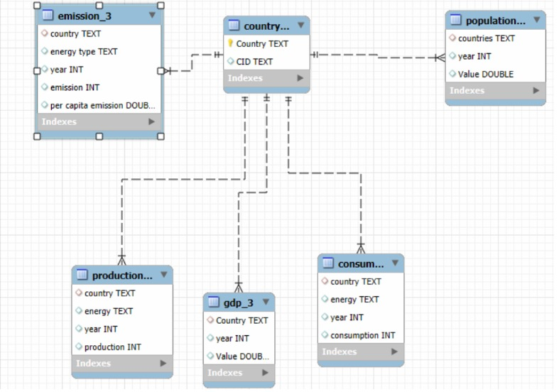

# 🌍 Energy Consumption Analysis Using MySQL

## 📌 Project Overview

Energy Consumption Analysis Using MySQL is a data analytics project that explores global energy consumption, energy production, carbon emissions, GDP, and population data across countries and years.

The project uses relational database design and SQL queries to analyze energy and environmental trends, compare countries, and understand the relationship between energy usage, economic growth, population, and carbon emissions.

## 🎯 Project Objectives

* Analyze carbon emissions across different countries.
* Identify countries with the highest carbon emissions.
* Compare energy production and consumption.
* Examine emissions by energy type.
* Analyze global emissions trends over time.
* Explore the relationship between population and emissions.
* Compare GDP and energy consumption across countries.
* Calculate per-capita emissions and energy consumption.
* Analyze emissions relative to GDP.
* Evaluate individual countries' contributions to global emissions.

## 🛠️ Tools and Technologies

* **Database:** MySQL
* **Query Language:** SQL
* **Database Management Tool:** MySQL Workbench
* **Dataset Format:** CSV
* **Database Design:** Entity Relationship Diagram (ER Diagram)
* **Documentation:** GitHub README and screenshots

## 📂 Project Structure

```text
Energy-Consumption-Analysis-MySQL/
│
├── Energy-Consumption-Analysis-MySQL/
│   ├── Dataset/
│   │   ├── consum_3.csv
│   │   ├── country_3.csv
│   │   ├── emission_3.csv
│   │   ├── gdp_3.csv
│   │   ├── population_3.csv
│   │   └── production_3.csv
│   │
│   ├── ER-Diagram/
│   │   └── ER.jpeg
│   │
│   └── Screenshots/
│       ├── Emissions relative to GDP.jpg
│       ├── Energy consumption per capita.jpg
│       ├── Energy production vs consumption.jpg
│       ├── Global emissions trend.jpg
│       ├── Global share of emissions.jpeg
│       ├── Highest-emission countries.jpg
│       ├── Population and emissions.jpg
│       └── Top 5 countries by GDP.jpg
│
├── README.md
└── energy_consumption_analysis.sql
```

*Note: The structure above reflects the extra project folder currently present in the repository. If your filenames differ, update the paths accordingly.*

## 🗃️ Database Design

The database consists of six tables that organize information about countries, emissions, energy production, energy consumption, GDP, and population.

| Table         | Description                                                  |
| ------------- | ------------------------------------------------------------ |
| `country`     | Stores country identifiers and country names.                |
| `emission_3`  | Stores carbon emissions by country, energy type, and year.   |
| `consumption` | Stores energy consumption by country, energy type, and year. |
| `production`  | Stores energy production by country, energy type, and year.  |
| `gdp_3`       | Stores GDP values by country and year.                       |
| `population`  | Stores population values by country and year.                |

The country table serves as a reference for connecting country-related information across the database. Primary keys and foreign keys help establish relationships and maintain data integrity.

## 🔗 Entity Relationship Diagram

The Entity Relationship Diagram represents the database structure and the relationships between its tables. It provides a visual overview of how country information connects with energy, emissions, GDP, and population data.



[View ER Diagram](Energy-Consumption-Analysis-MySQL/ER-Diagram/ER.jpeg)

## 📊 Key Analysis Areas

### 1. Carbon Emissions Analysis

* Identify countries with the highest carbon emissions.
* Compare emissions across different energy types.
* Analyze changes in global emissions over time.
* Calculate each country's share of global emissions.
* Compare emission levels across countries.

### 2. Energy Production and Consumption

* Compare energy production with energy consumption.
* Analyze energy consumption per capita.
* Evaluate energy production across countries.
* Examine changes in energy production over time.
* Identify differences between energy production and consumption.

### 3. Economic Analysis

* Identify countries with the highest GDP.
* Compare GDP across countries and years.
* Analyze emissions relative to GDP.
* Explore the relationship between economic activity and energy consumption.
* Investigate the connection between economic growth and environmental impact.

### 4. Population Analysis

* Compare population size with carbon emissions.
* Analyze per-capita emissions.
* Examine energy consumption in relation to population.
* Explore differences in emissions between countries with different population sizes.

### 5. Global Trends and Comparisons

* Analyze changes in energy and emissions data over time.
* Compare countries' contributions to global emissions.
* Identify patterns in energy consumption and production.
* Explore relationships between economic indicators and environmental impact.

## 🧠 SQL Concepts Used

The project applies SQL concepts for database creation, data retrieval, data aggregation, and multi-table analysis.

* Database creation and selection
* Table creation and schema design
* Primary keys and foreign keys
* Data retrieval using `SELECT`
* Filtering using `WHERE`
* Sorting using `ORDER BY`
* Aggregate functions such as `SUM()` and `AVG()`
* Grouping using `GROUP BY`
* Filtering aggregated results using `HAVING`
* Joining multiple tables
* Subqueries
* Common Table Expressions (CTEs)
* Window functions such as `LAG()`
* Ranking and comparative analysis
* Calculated metrics and year-over-year comparisons

## 🖼️ Project Screenshots

The `Screenshots` folder contains selected SQL query results that demonstrate the project's analysis.

The visual outputs cover:

* Highest-emission countries
* Global emissions trends
* Energy production versus consumption
* Energy consumption per capita
* Emissions relative to GDP
* Population and emissions comparisons
* Top countries by GDP
* Global share of emissions

These screenshots provide supporting evidence for the analyses performed using SQL.

## ⚙️ How to Run the Project

1. Install MySQL Server and MySQL Workbench.
2. Clone or download this GitHub repository.
3. Open `energy_consumption_analysis.sql` in MySQL Workbench.
4. Execute the database creation and table definition statements.
5. Import the CSV datasets from the `Dataset` folder into their corresponding tables.
6. Verify the table names, column names, data types, and country identifiers.
7. Ensure the data is loaded correctly before executing queries that depend on it.
8. Run the SQL analysis queries.
9. Review the query results and the screenshots included in the repository.

**Important:** Import the datasets before running the analysis queries. Follow the schema and foreign-key relationships defined in the SQL script.

## 💡 Key Learning Outcomes

Through this project, I gained practical experience in:

* Designing relational databases using MySQL.
* Organizing and connecting multiple datasets.
* Writing SQL queries for data analysis.
* Applying joins and aggregate functions to extract insights.
* Analyzing trends across countries and years.
* Comparing energy, economic, population, and emissions data.
* Using SQL to investigate relationships between different variables.
* Documenting a data analysis project using GitHub.

## 🚀 Conclusion

This project demonstrates how SQL can be used to analyze energy consumption, production, carbon emissions, GDP, and population data within a relational database.

By combining multiple datasets and applying analytical SQL queries, the project explores global energy patterns and the relationships between economic development, population, and environmental impact.

The project also strengthens practical skills in database management, data analysis, and structured project documentation.

## 👩‍💻 Author

**Menneni Yamini Rao**

* **GitHub:** [menneniyaminirao](https://github.com/menneniyaminirao)
* **LinkedIn:** [Connect with me](https://www.linkedin.com/in/menneni-yamini-rao-742153326/)

---

⭐ If you find this project useful, consider giving the repository a star.
